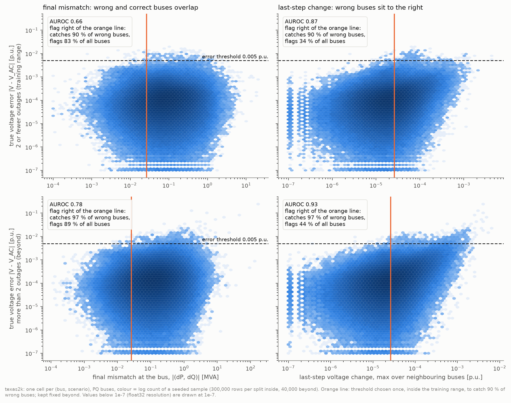
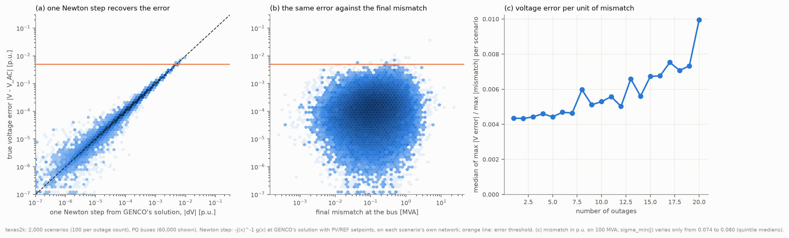
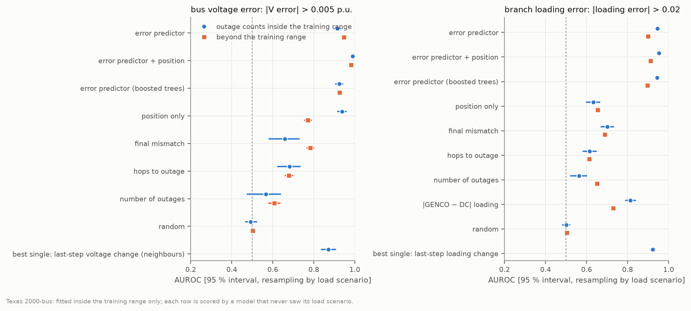
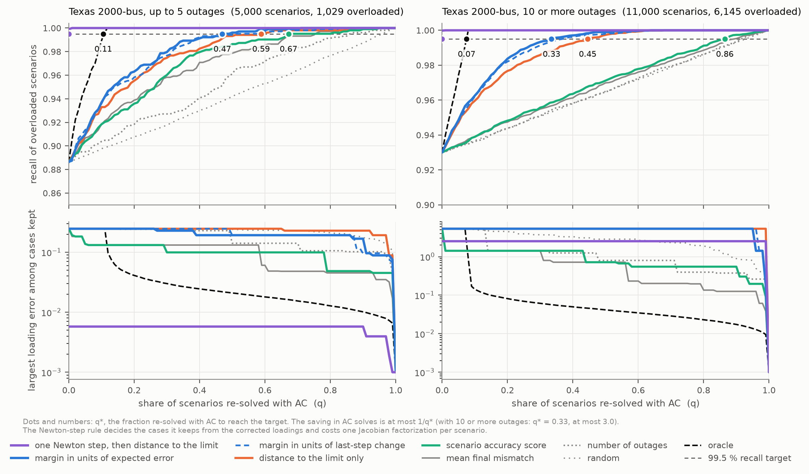
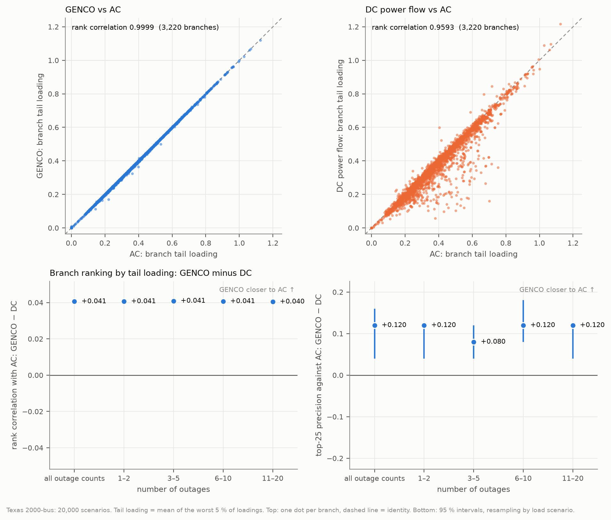
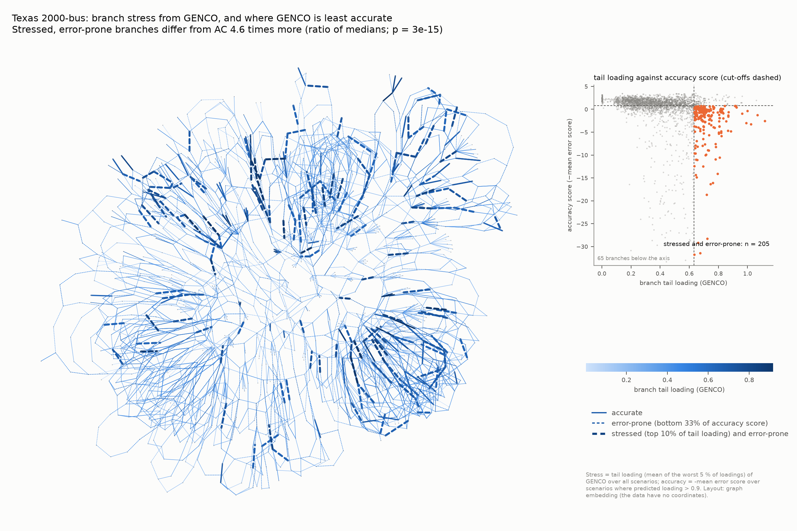

# Check GENCO Like Newton–Raphson: the Last Correction Step Shows When It Is Wrong

*Error checks, AC re-solve selection and contingency stress maps from GENCO's intermediate solutions*

**Figure 1.** GENCO's voltage error at each PQ bus against its final power mismatch (left) and against its last-step
voltage change (right), Texas 2000-bus. Top: 1–2 outages (training range); bottom: 3–20 outages. Dashed: error
threshold 0.005 p.u. Orange: per-check threshold set inside the training range to catch 90 % of wrong buses; it flags
83 % of all buses for the final mismatch and 34 % for the last-step change.

## 1. Problem and findings

GENCO (arXiv:2608.09921) is a graph neural solver for AC power flow that refines its solution in twelve correction
steps, feeding the power mismatch of each step back into the next. Its paper proposes the final mismatch, together with
violation checks, as the safeguard of a hybrid workflow in which an AC solver re-solves the cases GENCO may have got
wrong. The proposal is not tested. A Newton–Raphson solve is accepted on two criteria, a small mismatch and a small last
update; GENCO reports only the first and never says whether its state has settled.

We record all twelve intermediate solutions of the released checkpoints, without changing or retraining the model, on
44,476 contingency scenarios (Texas 2000-bus and IEEE 118-bus, 1 to 20 outages), and compare every check with AC power
flow.

| Question | Method | Finding |
|---|---|---|
| Is the final mismatch a good error check? | AUROC against AC error labels | No. AUROC 0.45–0.85; no better than chance for IEEE 118-bus voltages in two of three checkpoint seeds. |
| Does the record of the steps give a better one? | Last-step change of the voltage or loading estimate; no AC labels or training | Yes, for single buses and branches. AUROC 0.87–0.97 inside the training range, flagging 2.4 to 20 times fewer rows than the final mismatch. |
| Can a physics-based check do better? | One Newton step from GENCO's solution | Near-perfect. AUROC ≥ 0.9996; decides overloads almost exactly without an AC re-solve (7 wrong decisions in 20,000 Texas scenarios, against 1,806 for GENCO alone). |
| Which scenarios should be re-solved with AC? | Distance to the overload limit, scaled by expected error | 33.5 % of scenarios with 10 or more outages for 99.5 % overload recall, against 44.5 % for the distance alone. Ranking by error size or mismatch is close to random. |
| Do GENCO's stress maps agree with AC? | Tail loading per branch over all scenarios | Yes, far better than DC. Rank correlation 0.9999 (DC 0.959) on Texas 2000-bus. |

**Recommendation.** Where the network model is available, take one Newton step from GENCO's solution: it measures the
error almost exactly, removes most of it and decides overloads almost without AC re-solves. Without a Jacobian, use the
last-step change to flag unreliable buses and branches, and select scenarios for AC re-solve by their distance to the
overload limit in units of the last-step change or of a fitted error score. Do not rely on the final mismatch alone.

## 2. Setup and method

### 2.1 Task and data

GENCO produces states $\hat{\mathbf{x}}_t = (\hat V, \hat\theta, \hat P^g, \hat Q^g)$ for $t = 1,\dots,T$ with
$T = 12$ and reports $\hat{\mathbf{x}}_T$. At each step it computes the bus mismatch $(\Delta P_{i,t}, \Delta Q_{i,t})$
with its own branch-flow layer. Components that vanish by construction (ΔQ at PV and slack buses, ΔP at the slack bus)
are masked per scenario, since a generator outage can turn a PV bus into a PQ bus:

$$
r_{i,t} = \sqrt{m^P_i\,\Delta P_{i,t}^2 + m^Q_i\,\Delta Q_{i,t}^2} \quad [\text{MVA}], \qquad m^P_i, m^Q_i \in \{0,1\}.
$$

The branch loading is $L_b = \max(|S_{b,ft}|, |S_{b,tf}|)/\bar S_b$ and the branch is overloaded if $L_b > 1$. With
$V, L$ from AC power flow and $\hat V, \hat L$ GENCO's final values, we score two kinds of error: bus voltage error
$|\hat V_i - V_i| > \tau_V$ on PQ buses and branch loading error $|\hat L_b - L_b| > \tau_L$ on in-service branches.
Errors are rare (0.04–2.5 % of rows), so AUROC is reported together with AUPRC, which equals the error rate for a
random check.

| | Texas 2000-bus | IEEE 118-bus |
|---|---|---|
| Buses / branches | 2,000 / 3,220 | 118 / 186 |
| Checkpoint | `gridfm/genco-pf-contingency` | `gridfm/genco-pf-datakit`, base, seeds 0, 1, 42; small (width 24) |
| Outages in the checkpoint's training | up to 2 | exactly 1 |
| Test scenarios | first 1,000 of each published set with 1 to 20 outages (20,000) | 572 held-out single-outage scenarios and ten generated sets with 1 to 10 outages (23,904) |
| Error thresholds | $\tau_V = 0.005$ p.u., $\tau_L = 0.02$ | $\tau_V = 0.002$ p.u., $\tau_L = 0.05$ |

The IEEE 118-bus sets were generated with gridfm-datakit and PowerModels. Each threshold is the first configured value
with at least 200 errors inside the training range. AC power flow is the ground truth throughout; DC power flow is the
baseline for stress maps.

### 2.2 Recording

PyTorch forward hooks on GENCO's mismatch and branch-flow layers record the state, mismatch and branch flows at every
step. Quantities are converted to physical units with the checkpoint's own fitted per-unit base (137.93 MVA for IEEE
118-bus, 147.61 MVA for Texas 2000-bus; not 100 MVA). Thermal ratings come from the raw datakit tables, because GENCO's
power-flow input sets them to zero. Sanity checks on held-out data before any analysis: the hooks fire 12 times per
pass, the last recorded state is bitwise identical to GENCO's output, the recorded mean mismatch matches the value
GENCO stores (relative difference $2\times10^{-7}$), and the AC solution satisfies GENCO's own mismatch layer to
0.069 MVA.

### 2.3 Checks compared

All checks cost one GENCO pass unless stated otherwise.

- **Final mismatch** $r_{i,T}$: GENCO's proposed safeguard and the main baseline.
- **Last-step change** (no labels, no training):
  $s^V_i = \max_{j \in \mathcal{N}_1(i)} |\hat V_{j,T} - \hat V_{j,T-1}|$ over the in-service neighbours of bus $i$, and
  $s^L_b = \operatorname{std}(\hat L_{b,T-3},\dots,\hat L_{b,T})$. A row is flagged when $s \ge c$, with $c$ the largest
  threshold that flags 90 % of the wrong predictions inside the training range; $c$ is kept fixed for larger outage
  counts.
- **Error predictor** (fitted): a logistic regression on features of the twelve-step record (final mismatch, decay
  slope, number of rising steps, last-step changes and their neighbourhood maxima; for branches, loading drift and
  spread). Its log-odds is the **error score**.
- **Newton step** $\Delta\mathbf{x} = -\mathbf{J}(\hat{\mathbf{x}})^{-1}\mathbf{g}(\hat{\mathbf{x}})$ from GENCO's state, with
  $\mathbf{g}$ the reduced mismatch and $\mathbf{J}$ its Jacobian. To first order
  $\|\hat{\mathbf{x}} - \mathbf{x}^*\| \lesssim \|\mathbf{g}\|/\sigma_{\min}(\mathbf{J})$, so the step estimates GENCO's
  state error at the cost of one Jacobian factorization. It also explains how a small mismatch can hide a large error:
  the error at bus $i$ is row $i$ of $\mathbf{J}^{-1}$ applied to the mismatch of the whole network, which the local
  mismatch does not measure.
- **Uncertainty baselines:** the spread of $\hat V, \hat L$ over eight passes with loads scaled by $1 + 0.01\,\xi$,
  $\xi \sim \mathcal{N}(0,1)$ (seven extra passes), and, on IEEE 118-bus, the spread over the three released base
  seeds (two extra trained models).
- **Position only:** a model of the number of outages, hop distances to the outaged element, to the nearest
  voltage-controlled bus and to the slack bus, and the bus degree. Errors grow near outages and with their number
  (median final mismatch on Texas 2000-bus: 0.190 MVA at the buses of an outaged element, 0.071 MVA at five or more
  hops; 0.062 MVA with one outage, 0.125 MVA with 20), so a check is useful only if it adds to position.

### 2.4 Testing protocol

datakit builds several topologies per load scenario, so scenarios sharing a load scenario are not independent. Every
fold, resample and calibration split is grouped by load scenario, and each row is scored by the fold model that never
saw its load scenario. Fitted checks use only outage counts of GENCO's training data (up to 2 on Texas, exactly 1 on
IEEE 118-bus); all higher counts test transfer beyond the training range. Intervals are 95 % percentile intervals from
resampling load scenarios; differences between checks use paired resamples.

### 2.5 Selection for AC re-solve and stress maps

A rule scores each scenario and the top share $q$ is re-solved with AC. The required share is
$q^* = \min\{q : \text{recall of overloaded scenarios}(q) \ge 0.995\}$. With $\hat L^{\max}_s = \max_b \hat L_{s,b}$,
the rules compared are:

- **distance to the limit** $-|\hat L^{\max}_s - 1|$, our reading of the violation check in the GENCO paper;
- **distance in units of expected error:** each branch's margin to 1 divided by its error scale (an isotonic fit of the
  loading error on the error score); a scenario's score is the smallest value that would flip its overload decision;
- **error-size rules:** scenario accuracy score (best of four pre-declared aggregates of the error score) and mean
  final mismatch; plus number of outages, random and an oracle;
- **added after all other results:** distance after one Newton step (scenarios not re-solved take their decision from
  the corrected loadings), and distance in units of the last-step change.

**Stress maps.** For each branch and source (GENCO, AC, DC) the tail loading is
$\mathrm{CVaR}_{0.95}(L_b) = \mathbb{E}[L_b \mid L_b \ge \mathrm{VaR}_{0.95}(L_b)]$, the mean of the worst 5 % of
loadings. It replaces overload probability for ranking because most branches never overload, which leaves that
probability tied at zero. Agreement with AC is the Spearman rank correlation across branches and the precision of the
top-25 set. **Stress and accuracy map:** a branch is *stressed* if its GENCO tail loading is in the top 10 %, and
*error-prone* if the mean error score over the scenarios in which it is near its limit is in the worst third. A
one-sided Mann–Whitney test compares the disagreement $|\mathrm{CVaR}_{\text{GENCO}} - \mathrm{CVaR}_{\text{AC}}|$ of
stressed error-prone and stressed accurate branches.

## 3. Results

### 3.1 The final mismatch is a weak error check

The final mismatch gives AUROC 0.659 and 0.783 for Texas bus voltages inside and beyond the training range, and 0.454
[0.389, 0.521] inside the training range for IEEE 118-bus (seeds 1 and 42: 0.480 [0.420, 0.537] and 0.594). A small
mismatch can hide a large state error: one Newton step, which computes $\mathbf{J}^{-1}\mathbf{g}$, matches the true
voltage error almost perfectly (Spearman 0.998 on both systems), while the same errors scatter without pattern against
the local mismatch (Figure 2). The error per unit of mismatch grows with the number of outages, 2.3-fold from 1 to 20
on Texas. Conditioning explains little of this on Texas ($\sigma_{\min}(\mathbf{J})$ varies only from 0.074 to 0.080
across quintile medians). A second reason is expected but untested: GENCO's loss penalises the mismatch at every step,
so it may be small for right and wrong states alike.

**Figure 2.** Texas 2000-bus, 100 scenarios per outage count. (a) True voltage error per PQ bus against one Newton step
from GENCO's solution (dashed: equality). (b) The same errors against the final mismatch at the bus. (c) Median over
scenarios of the largest voltage error divided by the largest mismatch, per number of outages.

### 3.2 The last-step change is a strong error check for single buses and branches

How much the estimate still moves in the last step separates wrong from correct predictions far better than the final
mismatch, without AC labels or training (only its threshold needs labels inside the training range).

| System | Check | AUROC, bus | AUROC, branch | Beyond training range, bus: caught / flagged |
|---|---|---|---|---|
| Texas 2000-bus | Last-step change | 0.871 | 0.923 | 97 % / 44 % |
| | Final mismatch | 0.659 | 0.702 | 97 % / 89 % |
| | Error predictor (needs AC labels) | 0.916 | 0.945 | 96 % / 34 % |
| IEEE 118-bus | Last-step change | 0.967 | 0.972 | 48 % / 5 % |
| | Final mismatch | 0.454 | 0.672 | 99 % / 96 % |
| | Error predictor (needs AC labels) | 0.976 | 0.988 | 84 % / 10 % |

**Table 1.** AUROC inside the training range. "Caught / flagged": with the threshold fixed inside the training range
to catch 90 % of wrong predictions, the share of wrong predictions caught and of all rows flagged beyond it. Intervals
are in `results/<system>/last_step_check.csv`.

**Figure 3.** AUROC with 95 % intervals for bus voltage errors (left) and branch loading errors (right), Texas
2000-bus. Circles: inside the training range; squares: beyond it.

Inside the training range the last-step change has 8 to 35 times the AUPRC of the final mismatch. The fixed Texas
thresholds catch 97 % of wrong bus voltages and 85 % of wrong branch loadings with 3 to 20 outages. The fitted error
predictor beats the final mismatch in every cell (paired AUROC differences +0.085 to +0.522, all intervals excluding
zero). Beyond the training range on Texas it reaches 0.947 against 0.783 for the final mismatch and 0.771 for position
only. Its most informative features all describe how much the state still moves at the end.

Precision stays low because errors are rare: catching 90 % of wrong Texas bus voltages flags 34 % of buses at 0.1 %
precision. On IEEE 118-bus the neighbourhood voltage score does not transfer (48 % caught beyond the training range;
the own-bus change catches 83 %). Inside the training range, position alone predicts bus voltage errors as well as the
error predictor (Texas 0.937 against 0.916), so the value of the step-wise signals appears under contingency shift.

### 3.3 One Newton step is a near-perfect check

| Check | Cost beyond the GENCO pass | AUROC range over system, label and range |
|---|---|---|
| Newton step | one Jacobian factorization; needs the network model | ≥ 0.9996 |
| Seed spread | two more trained models; IEEE 118-bus only | 0.96–0.99 |
| Last-step change | none | 0.79–0.97 |
| Load-perturbation spread | seven more passes | 0.47–0.83 |
| Final mismatch | none | 0.44–0.85 |

**Table 2.** Eight cells: bus and branch labels, inside and beyond the training range, on Texas (100 scenarios per
outage count) and IEEE 118-bus (the ten generated sets).

One Newton step separates wrong from correct predictions almost perfectly (AUPRC ≥ 0.98; Spearman with the true error
0.998 for voltages, 0.999–1.000 for loadings), as Newton–Raphson theory predicts for a state close to the solution.
Taking the step also cuts the median voltage error on Texas about 100-fold ($1.0\times10^{-4}$ to $1.1\times10^{-6}$ p.u.).
Among checks that cost nothing beyond the GENCO pass, the last-step change is the best; it comes within 0.01–0.04 AUROC
of the seed spread from a single model and a single pass.

### 3.4 Selecting scenarios for AC re-solve

**Figure 4.** Texas 2000-bus, up to 5 outages (left) and 10 or more (right). Top: overload recall against the share
re-solved with AC; dots mark the smallest share reaching 99.5 %. Bottom: largest remaining loading error among
scenarios kept without AC. Purple: one Newton step, which reaches the target with no re-solve.

| Rule | Texas, all | IEEE 118-bus, all | Iterations, Texas | Iterations, IEEE 118-bus |
|---|---|---|---|---|
| † One Newton step, then distance to limit | 0.000 | 0.001 | 1.00 | 1.00 |
| Distance in units of expected error | **0.364** | **0.127** | 0.96 | 0.30 |
| † Distance in units of last-step change | 0.412 | 0.141 | 1.09 | 0.34 |
| Distance to limit | 0.517 | 0.164 | 1.37 | 0.39 |
| Scenario accuracy score | 0.814 | 0.908 | 2.15 | 2.16 |
| Mean final mismatch | 0.840 | 0.920 | 2.22 | 2.18 |
| Random | 0.939 | 0.862 | | |
| AC alone, flat start | 1 | 1 | 4.08 | 4.04 |

**Table 3.** Share of scenarios re-solved with AC for 99.5 % recall of overloaded scenarios, and cost in Newton
iterations per scenario (one per Jacobian factorization plus the share times the mean iterations of a warm-started
re-solve). † Added after all other results.

Overload decisions taken after one Newton step are wrong in 7 of 20,000 Texas scenarios, against 1,806 for GENCO alone,
and in 139 against 1,211 on IEEE 118-bus, without any AC re-solve. The gain is in correctness, not cost: counted in
Newton iterations the step costs 1.0 per scenario, about the same as the best rule without a Jacobian on Texas (0.96)
and more on IEEE 118-bus (0.30), where 95 % of scenarios are overloaded.

Without a Jacobian, the distance to the limit is the fair baseline. Scaling it by expected error lowers the required
share with 10 or more outages from 44.5 % to 33.5 % (paired interval of the difference [−0.154, −0.058]); scaling by the
last-step change, which needs no AC labels, gives 36.9 %. Ranking by error size alone, whether by accuracy score, final
mismatch or last-step change, needs 67–93 % of scenarios, close to a random order (86–96 %): a missed overload is a
scenario whose highest loading is just below 1, so the distance to the limit matters as much as the error size. AC
re-solves started from GENCO's solution need 37 % (Texas) and 41 % (IEEE 118-bus) fewer Newton iterations than flat
starts.

Re-solving a share $q^*$ cuts the number of AC solves by at most a factor $1/q^*$ (2.7 over all Texas scenarios for the
distance in units of expected error), independent of hardware. We make no wall-clock speed-up claim: it depends on the
AC solver and hardware, neither of which was benchmarked against production tools.

### 3.5 Stress maps

**Figure 5.** Texas 2000-bus, 20,000 scenarios. Top: tail loading per branch from GENCO (left) and DC (right) against
AC. Bottom: paired differences (GENCO − DC) of rank correlation and top-25 precision with AC, per range of outage
counts.

| Tail loading | Rank correlation, GENCO | Rank correlation, DC | Top-25 precision, GENCO | Top-25 precision, DC |
|---|---|---|---|---|
| Texas 2000-bus | 0.9999 | 0.959 | 1.00 | 0.88 |

On Texas, GENCO is closer to AC than DC in every range of outage counts (rank correlation +0.041 [0.040, 0.041], top-25
precision +0.12 [0.04, 0.16]). DC's rank correlation is 0.959 in every range, so its error is structural, consistent
with its neglect of reactive flow; part of the gap is a choice of measure, since DC loading uses active power only. Of
the 364 branches that overload at least once under AC, GENCO finds 324 (24 false alarms) and DC 265 (5 false alarms).
Rank correlation across 3,220 branches is dominated by fixed differences between branches and is close to 1 for any good
estimate; top-25 precision and the counts of branches found are more discriminating. These rankings aggregate 20,000
scenarios, which averages out GENCO's errors: they show that GENCO ranks where the grid is stressed, not that
individual flows are exact.

**Stress and accuracy map.** Of the 322 stressed branches on Texas, 205 are error-prone. Their GENCO tail loading
differs from AC's by a median of $9.6\times10^{-4}$, against $2.1\times10^{-4}$ for the 117 accurate ones (ratio 4.6;
one-sided $p = 3\times10^{-15}$, rank-biserial 0.52).

**Figure 6.** Texas 2000-bus. Branch colour: GENCO tail loading. Dashed: error-prone; thick dashed: stressed and
error-prone. Inset: tail loading against accuracy score; the 205 stressed error-prone branches are highlighted.

Stress and accuracy are correlated (Spearman −0.38), so the comparison was controlled for stress: the groups have
similar tail loading (median 0.700 against 0.679), the effect holds within every stress quartile ($p \le 0.004$) and in
a regression on stress (factor 4.15). The accuracy score comes from the error predictor, so this is the error-check
result aggregated to branches. Aggregated the same way, $|\hat L - L^{\text{DC}}|$ gives rank-biserial 0.40, the final
mismatch 0.04 and a random score 0.03. The absolute disagreements are small (median $\le 10^{-3}$ of the rating): the
map shows where to verify with AC, not that GENCO is unusable.

### 3.6 Negative results

- **The shape of the mismatch carries no signal.** We expected wrong buses to show stalling, oscillation or slow decay
  in the mismatch over the steps. Tail ratio, number of rising steps and overshoot score 0.34–0.48 AUROC (below chance)
  for own-bus voltage errors inside the training range, against 0.84 (Texas) and 0.97 (IEEE 118-bus) for the size of
  the last-step change.
- **GENCO's gradients are poor sensitivities.** On IEEE 118-bus, $\partial L_b/\partial P^d_i$ by automatic
  differentiation through the twelve steps has the right sign on all influential buses and roughly the right scale, but
  ranks buses worse than DC distribution factors (rank correlation 0.83 / 0.81 / 0.76 against 0.99 / 0.99 / 0.98 for 1,
  5 and 10 outages) and degrades with the number of outages. Accurate states do not imply accurate derivatives.

## 4. Limitations

The evidence rests on two systems and, for Texas 2000-bus, on the single released contingency checkpoint, with the first
1,000 of about 8,800 scenarios of each test set and uniformly sampled outages, whereas real outages are clustered. The
IEEE 118-bus contingency sets are ours and the checkpoint was trained on single outages only, so every higher outage
count is beyond its training range. Several protocol choices were made after seeing development results: the 200-error
rule for the headline threshold, the distance-to-limit rules (defined on IEEE 118-bus, then tested on Texas), the
choice of scenario-score aggregate, and tail loading instead of overload probability. The Newton-step and last-step
selection rules were defined after all other results, so neither system is a held-out test for them, and the error
scale of the distance rule is fitted inside the training range, which may make its shares for up to 5 outages and for
all outage counts slightly optimistic. The stress and accuracy test cannot be run on IEEE 118-bus: both methods reach
the top 25 there, a ceiling on 186 branches, and only 1 of 19 stressed branches is error-prone.

The results do not show that the step-wise signals add to position inside the training range, where position alone
predicts bus voltage errors equally well; they flag large errors without measuring them (rank correlation with the true
error 0.26–0.36 for Texas buses, against 0.998 for the Newton step); and taken as the largest value per scenario they
detect scenarios with a wrong element worse than the final mismatch (AUROC 0.68–0.72 against 0.86 on Texas), so they
cannot accept whole scenarios. Thresholds fixed inside the training range flag at least one element in every scenario
and, on IEEE 118-bus, do not transfer for the neighbourhood voltage score. Selection rules that target missed overloads
do not bound flow errors: errors up to 5.3 times the rating remain among kept scenarios on Texas, and one Newton step
leaves up to 2.5 times the rating, so applications that need bounded flows must also gate on error size. The Newton-step
cost assumes a factorization costs as much as one Newton iteration, and no wall-clock claim is made. The stress and
accuracy map is partly the error check aggregated to branches, and it measures how hard a case is for GENCO, not how
weak the grid is: no investment or reinforcement conclusions are drawn.

## References

- A. Puech et al. GENCO — A unified neural solver embedded in a development framework for steady-state grid analysis.
  arXiv:2608.09921, 2026.
- gridfm-datakit. arXiv:2512.14658.
- R. T. Rockafellar and S. Uryasev. Optimization of conditional value-at-risk. *Journal of Risk*, 2(3):21–41, 2000.

## Authors and contact

Ioannis Karampinis, Technical University of Denmark · Christos Doudesis

Contact: iokar@dtu.dk, chrisdoudesis23@gmail.com

Code: https://github.com/radiakos/genco-xray
